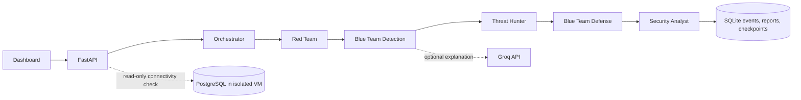

# PEGASUS-X architecture

The Red Team's scenario runner is deliberately bounded to synthetic telemetry and harmless control-validation events. PostgreSQL connectivity does not execute attack payloads.
